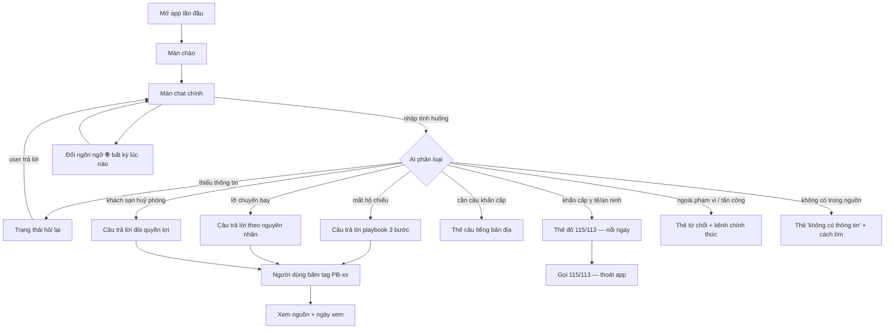

# Wireframe & UI Flow — Travel SOS

> Phong cách **natural**: giao diện như một cuộc nhắn tin với người tư vấn thân thiện — bong bóng chat, câu chữ ấm và tự nhiên, không dashboard, không jargon. Mọi câu trả lời AI luôn đi kèm nguồn (`PB-xx`) và lời nói thật khi không chắc.
> Khớp PRD §4 (11 bước) — mỗi màn hình bên dưới là một **trạng thái của cùng một màn hình chat**.

---

## 1. Nguyên tắc thiết kế (natural style)

| Nguyên tắc | Thể hiện trên UI |
|---|---|
| Như nhắn tin, không như form | 1 ô nhập duy nhất ở đáy màn; AI chủ động hỏi từng ý, không đổ bảng câu hỏi |
| Nói thật, không hứa suông | Câu trả lời "rất khó kịp chuyến…" hiện kèm nhãn ⚠️ *Thời gian dự kiến — có thể thay đổi* |
| Nguồn luôn nhìn thấy | Mỗi bước có tag nhỏ `PB-01` — bấm là mở nguồn + ngày xem; không giấu ở chỗ khuất |
| Dẫn dắt, không bỏ rơi | Sau mỗi câu trả lời có 1–2 nút gợi ý việc tiếp theo ("Đã có biên bản → bước tiếp?") |
| An toàn nổi bật | Từ khoá nguy hiểm (máu, bị cướp, đau ngực…) → thẻ đỏ 115/113 nổi lên trước mọi thứ |
| Trả lời theo ngôn ngữ của câu hỏi | AI trả lời bằng ngôn ngữ du khách đang dùng (spec §4); selector 🌐 chỉ đổi ngôn ngữ giao diện (microcopy) |

---

## 2. UI Flow (sơ đồ chuyển màn)



Một màn hình duy nhất, **không có điều hướng phức tạp** — mọi thứ là trạng thái trong khung chat. Chỉ có 2 nơi thoát khung chat: xem nguồn (N) và thẻ khẩn cấp (J/O).

---

## 3. Wireframe các màn hình

### 3.1. Màn chào (bước 1)

Lưu ý: câu trả lời của AI theo ngôn ngữ của câu hỏi du khách nhắn (spec §4); màn chào chỉ giới thiệu, không chọn ngôn ngữ trả lời.

```
┌─────────────────────────────────────┐
│                                     │
│        🧭  Travel SOS               │
│   Mình luôn ở đây khi chuyến đi     │
│   không theo kế hoạch.              │
│                                     │
│   Bạn đang gặp chuyện gì?           │
│   Nhắn bằng tiếng Anh hoặc          │
│   tiếng Việt đều được.              │
│                                     │
│   ⓘ Mình chỉ tư vấn các bước,       │
│   mọi hành động bạn tự quyết.       │
└─────────────────────────────────────┘
```

### 3.2. Màn chat chính — trạng thái nghỉ (bước 2)

```
┌─────────────────────────────────────┐
│ 🧭 Travel SOS                🌐 EN ▾│
├─────────────────────────────────────┤
│                                     │
│  (không có tin nhắn)                │
│                                     │
│  Chào bạn! Kể mình nghe chuyện      │
│  gì đang xảy ra nhé — ví dụ:        │
│  "I lost my passport in Hanoi".     │
│                                     │
│  ┌───────────────────────────────┐  │
│  │ Gợi ý nhanh:                  │  │
│  │ (Lost passport) (Missed flight)│ │
│  │ (Hotel cancelled) (Say it in  │  │
│  │  Vietnamese)                  │  │
│  └───────────────────────────────┘  │
├─────────────────────────────────────┤
│ ┌─────────────────────────┐ (➤)    │
│ │ Nhắn tình huống của bạn…│        │
│ └─────────────────────────┘        │
└─────────────────────────────────────┘
```

### 3.3. Trạng thái hỏi lại — thiếu thông tin (bước 4, US-05)

```
│  Bạn: I lost my passport, help!    🧍│
│                                     │
│  🧭 Ôi, bình tĩnh nhé, mình sẽ      │
│  hướng dẫn từng bước. Trước hết     │
│  mình cần biết vài điều:            │
│                                     │
│  1️⃣ Bạn đang ở tỉnh/thành nào?      │
│  2️⃣ Bạn mất hộ chiếu ở đâu?         │
│                                     │
│  (Còn 2 câu nữa mình sẽ hỏi sau —   │
│  trả lời dần không sao.)            │
│                                     │
│  ⓘ Mình không đoán thay bạn — nói   │
│  sai địa phương thì hướng dẫn sẽ sai.│
```

### 3.4. Câu trả lời playbook — mất hộ chiếu (bước 5–7, US-01/02/04)

```
│  🧭 Đây là 3 bước, làm đúng thứ     │
│  tự nhé:                            │
│                                     │
│  ┌───────────────────────────────┐  │
│  │ BƯỚC 1 · Trình báo công an    │  │
│  │ ⚠️ Ở công an NƠI BỊ MẤT,       │  │
│  │ không phải nơi bạn đang ở.    │  │
│  │ Mang theo: ảnh chụp hộ chiếu  │  │
│  │ (nếu có), ảnh thẻ, thông tin  │  │
│  │ nơi lưu trú, vé máy bay.      │  │
│  │ Nhớ xin bản sao biên bản.     │  │
│  │ Nguồn: [PB-01] [PB-02]        │  │
│  ├───────────────────────────────┤  │
│  │ BƯỚC 2 · Đại sứ quán của bạn  │  │
│  │ Xin giấy thông hành khẩn cấp  │  │
│  │ hoặc hộ chiếu mới.            │  │
│  │ Nguồn: [PB-03]                │  │
│  ├───────────────────────────────┤  │
│  │ BƯỚC 3 · Xin thị thực xuất    │  │
│  │ cảnh tại Cục XNC              │  │
│  │ ⚠️ Có thể mất đến ~5 ngày     │  │
│  │ làm việc — *dự kiến, có thể   │  │
│  │ thay đổi.*                    │  │
│  │ Nguồn: [PB-04]                │  │
│  └───────────────────────────────┘  │
│                                     │
│  Bạn muốn mình soạn câu tiếng Việt  │
│  để đưa công an đọc không?          │
│  [Có, soạn giúp] [Đã có biên bản →  │
│                   bước tiếp]        │
```

### 3.5. Trạng thái nói thật — kẹt thời gian (US-06)

```
│  Bạn: Lost passport in Da Nang,     │
│       flight to Seoul 8am tomorrow. │
│                                     │
│  🧭 Nói thẳng: rất khó kịp chuyến   │
│  8h sáng mai — thị thực xuất cảnh   │
│  thường mất vài ngày làm việc.      │
│                                     │
│  Việc nên làm ngay, song song:      │
│  • Gọi hãng bay xin dời/đổi vé      │
│  • Bắt đầu 3 bước ở trên            │
│                                     │
│  ⚠️ Mình không thể hứa "vẫn kịp".   │
│  Nguồn: [PB-04]                     │
```

### 3.6. Thẻ khẩn cấp — y tế / an ninh (US-22, nổi lên trên cùng)

```
┌─────────────────────────────────────┐
│ 🚨 GỌI NGAY                         │
│  ┌──────────────┐ ┌──────────────┐  │
│  │ 115 Cấp cứu  │ │ 113 Công an  │  │
│  └──────────────┘ └──────────────┘  │
│  Rồi báo Đại sứ quán của bạn.       │
│  Mình không tư vấn y tế được —      │
│  gọi trước, mình giúp phần sau.     │
└─────────────────────────────────────┘
```

### 3.7. Thẻ từ chối & thẻ "không có thông tin" (US-10/12/14)

```
│  🧭 Câu này mình không giúp được —  │
│  dùng dịch vụ "lo nhanh" rất dễ     │
│  bị lừa hoặc vi phạm luật.          │
│  Kênh chính thức: Cục XNC (bước 3   │
│  ở trên).  Nguồn: [PB-04]           │

│  🧭 Số điện thoại Đại sứ quán       │
│  Bhutan không có trong nguồn của    │
│  mình, mình không đoán bừa được.    │
│  Cách tìm chắc chắn: trang Bộ       │
│  Ngoại giao nước đó · Cổng thông    │
│  tin Lãnh sự.                       │
```

### 3.8. Xem nguồn khi bấm tag `PB-xx` (màn phụ, đóng lại được)

```
┌─────────────────────────────────────┐
│ ← Nguồn PB-04                    ✕  │
├─────────────────────────────────────┤
│ "Xin thị thực xuất cảnh tại Cục     │
│  Quản lý Xuất nhập cảnh"            │
│                                     │
│  🔗 hanoitimes.vn/…                 │
│  Ngày xem: 27/11/2026               │
│                                     │
│  ⚠️ Con số có thể thay đổi — luôn   │
│  gọi xác nhận trước khi di chuyển.  │
└─────────────────────────────────────┘
```

---

## 4. Ghi chú triển khai

- **1 màn hình, nhiều trạng thái** — team chỉ cần dựng khung chat + 5 loại thẻ (bước, cảnh báo, khẩn cấp, từ chối, nguồn); agent quyết định thẻ nào hiện.
- Thẻ khẩn cấp (3.6) **nổi trên mọi thứ** khi phát hiện từ khoá nguy hiểm — không chờ luồng hỏi lại.
- Microcopy mặc định tiếng Anh; khi user đổi ngôn ngữ 🌐, cả câu chào + gợi ý nhanh đổi theo. Câu trả lời của AI thì theo **ngôn ngữ của câu hỏi** (spec §4) — không phụ thuộc selector.
- Nút gợi ý ("Đã có biên bản → bước tiếp?") chỉ là **văn bản điền sẵn vào ô nhập** — user vẫn phải bấm gửi; agent không tự làm gì.
- Không hiện bất kỳ con số nào ngoài phần có tag `PB-xx` hoặc chữ *"dự kiến"*.
