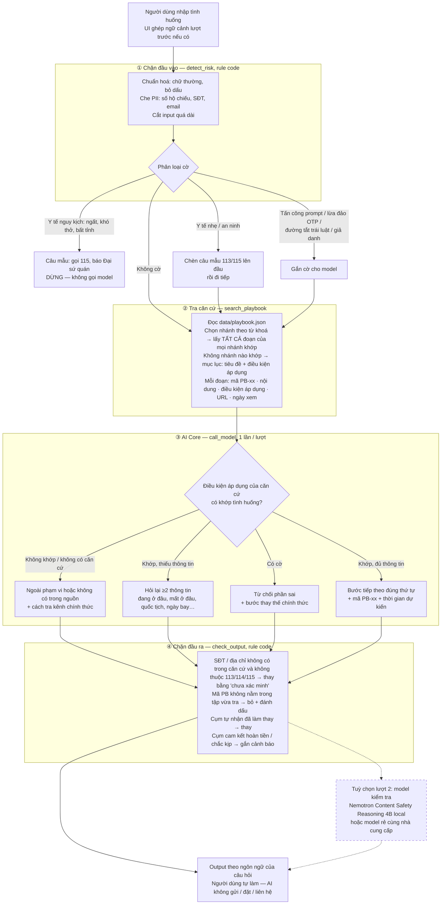

# AI SPEC — [Tên lát cắt] · Nhóm [tên nhóm] · Phòng [XXX] · Zone [X]

> Mốc nộp: §7 chốt chuẩn "đạt" tại **CP2 19:30 Thứ Sáu 27/11** · §0–§7 nộp **CP3 10:00 Thứ Bảy 28/11** · đủ §0–§10 **CP4 14:30 Thứ Bảy 28/11** · §10 changelog ghi tiếp đến **23:59 Thứ Bảy 28/11**.
> Đầu mỗi mục ghi bước guide (`02-guide.md` trong repo đề) chỉ cách điền. Mỗi mục ngắn, có số và nguồn; chi tiết để ở file được trỏ tới. Xoá dòng hướng dẫn trong ngoặc vuông khi điền xong.

Track: [ ] A · [ ] B · [ ] C · [ ] D · [ ] E — bài toán: [đề gợi ý trong file track, hoặc bài toán nhóm tự mở rộng] __
Data BTC cấp đã dùng (nếu có — không commit nguyên file): __

## §0. Hiện tại việc này diễn ra thế nào *(guide 1.1)*
- Luồng hiện tại của việc này, trong khoá hoặc trên app thật (3–5 bước; ảnh chụp từ tài khoản của mình, đã che thông tin):
- Công cụ / AI đang được dùng cho việc này (nếu có) + nguồn. Không kiểm được thì ghi "chưa kiểm":

## §1. Người dùng & bằng chứng *(guide 1.1, 1.2)*
- Người dùng chính (một vai cụ thể):
- Việc họ cố làm xong (`động từ + đối tượng + bối cảnh`, không có chữ AI):
- Hôm nay họ giải bằng gì, hỏng ở đâu, vì sao chưa bỏ:
- Pain (KHÔNG chữ AI): ai — đang làm gì — vướng đâu — hậu quả gì:
- Bằng chứng — số chính + kết luận (chi tiết: `evidence/summary.md`): __

## §2. Impact & quyết định chọn *(guide 1.3)*

| Hướng | Bao nhiêu người gặp | Bao nhiêu lần / tháng | Mỗi lần tốn gì | Impact / tháng | Làm kịp không | Chọn? |
|---|---|---|---|---|---|---|
|  |  |  |  |  |  |  |
|  |  |  |  |  |  |  |
|  |  |  |  |  |  |  |

- **Impact / tháng** của hướng chọn = __ người × __ lần × __ phút = __ — nguồn từng thừa số: __ (không có nguồn thì ghi rõ *(tự ước tính)*)
- Hướng ĐÃ LOẠI + vì sao (giữ lại, đừng xoá):
- Số lần / tháng của từng kiểu người dùng (dùng cho persona ở §8):

## §3. Giải pháp tương tự *(guide 2.1)*
- [sản phẩm / tính năng gần giống]: một điều đáng học · một điều đáng né · mình khác gì

## §4. Thiết kế *(guide 2.2, 3.2)*
- **Lát cắt MỘT CÂU** (1 người dùng · 1 việc · 1 quyết định AI · 1 kết quả): Du khách nước ngoài vừa mất hộ chiếu tại Việt Nam mô tả tình huống → AI chọn **bước tiếp theo đúng thứ tự** trong quy trình 3 bước (công an nơi mất → Đại sứ quán → Xuất nhập cảnh), hoặc **hỏi lại** khi thiếu thông tin, dựa trên playbook có mã nguồn `PB-xx` → kết quả đo bằng % câu benchmark đạt và 0 số liệu/địa chỉ không có nguồn. *(Luồng phụ cùng kiến trúc, theo PRD: lỡ chuyến/hoãn-huỷ chuyến US-16/17, khách sạn huỷ phòng US-18, rào cản ngôn ngữ US-20.)*
- Không làm (≥3 điều):
  - Không đặt/dời vé, không gửi mail, không liên hệ hãng bay/khách sạn/cơ quan thay người dùng — chỉ gợi ý bước.
  - Không tư vấn y tế — chỉ hướng dẫn gọi 115/113 (US-22).
  - Không tra cứu thời gian thực địa chỉ/SĐT/giờ mở cửa ngoài playbook (US-10 chỉ chỉ cách tra).
  - Không xử lý khách Việt mất hộ chiếu ở nước ngoài và khách sạn đòi thêm tiền (US-19) — trả lời "ngoài phạm vi" + chỉ kênh chính thức.
  - Không lưu phiên hội thoại phía server — UI tự ghép ngữ cảnh lượt trước vào input.
- **Sơ đồ** (Mermaid):

- **Hình dạng:** [x] workflow cố định · [ ] một agent · [ ] nhiều agent — Luồng luôn giống nhau (chặn vào → tra căn cứ → gọi model 1 lần → chặn ra), không cần AI tự chọn bước. Không chọn agent vì vòng lặp tốn token hơn, khó đo hơn và dễ đi chệch; với tình huống khẩn, độ trễ thấp và hành vi đoán trước được quan trọng hơn độ linh hoạt.
- **AI dựa vào đâu** — mỗi công cụ (khớp `codebase/tools.py` — *chưa code, sẽ viết đúng tên này*):

  | Công cụ | Input | Output | Tác động ra ngoài? |
  |---|---|---|---|
  | `detect_risk` | input người dùng (str) | `{flags, muc_y_te, text_masked}` — cờ rủi ro + input đã che PII | Không |
  | `search_playbook` | input đã che PII (str) | danh sách đoạn `{code, nhanh, tieu_de, noi_dung, dieu_kien, so_duoc_phep, url, ngay_xem}` đọc từ `data/playbook.json` | Không |
  | `check_output` | câu trả lời của model + danh sách mã PB vừa tra + căn cứ | `{output, fixes}` — câu trả lời đã lọc + danh sách chỗ đã sửa (ghi trace) | Không |

- **Playbook & cách tra:** file `data/playbook.json` (đọc bằng thư viện chuẩn `json`), 4 nhánh `ho_chieu` · `chuyen_bay` · `luu_tru` · `ngon_ngu`; mỗi đoạn có thêm `tu_khoa` (Việt + Anh) để chọn nhánh. Chuẩn hoá input (chữ thường, bỏ dấu) → lấy mọi nhánh có từ khoá khớp → trả toàn bộ đoạn của nhánh (giữ đủ các bước của quy trình); không khớp → trả mục lục. Ghi `note("playbook: nhánh=…")` vào trace. Không dùng vector search vì playbook nhỏ (khoảng 20–40 đoạn, *tự ước tính*), cần thêm thư viện / API và khó giải thích khi sai.
- **Mức tự động:** [x] AI gợi ý, người quyết · [ ] AI tự làm khi chắc, chuyển người khi không · [ ] AI tự làm — AI chỉ đưa bước và câu mẫu; mọi việc thật (ra đồn, gọi ĐSQ, đổi vé) do du khách tự làm. Sai thì du khách mất thời gian, tiền đổi vé, có thể bị phạt — đắt và khó sửa, nên AI không được làm thay.
- **Chỗ chặn rủi ro** (rủi ro lớn nhất của lát cắt bị chặn ở đâu, bằng gì):
  - Rủi ro lớn nhất: **khẳng định sai mà trông như đúng** — bịa SĐT/địa chỉ, hứa hoàn tiền/kịp giờ, áp quy trình sai đối tượng. Chặn bằng: ② playbook có *điều kiện áp dụng* + ③ SYSTEM prompt bắt kiểm điều kiện trước khi dùng căn cứ + ④ rule kiểm SĐT/địa chỉ/mã PB/cụm tự nhận.
  - Tấn công prompt, lừa đảo OTP, đường tắt trái luật: ① gắn cờ + ③ SYSTEM prompt (lớp chính) + ④ chốt cuối.
  - Khẩn cấp y tế: ① câu mẫu 115/113, mức nguy kịch thì không gọi model.
  - Mọi lần ① gắn cờ và ④ sửa đều ghi `note()` vào trace để đếm bắt đúng/bắt nhầm sau mỗi lượt eval.
- **Chỗ người duyệt** (việc AI không được tự làm): Không có công cụ tác động ra ngoài nên không có hàng chờ duyệt; "người duyệt" chính là du khách — tự quyết và tự thực hiện mọi bước. AI không được: liên hệ ai thay, đặt/dời vé, gửi/nhận OTP, xác nhận việc chưa kiểm chứng.
- **Nguyên tắc thiết kế** (≥3, bắt buộc G10):

  | Nguyên tắc | Chỗ cụ thể trên sơ đồ / trong bản chạy thử |
  |---|---|
  | G10 — thu hẹp phạm vi khi không chắc | ③ nhánh "Khớp, thiếu thông tin" → hỏi lại; nhánh "Không khớp / không có căn cứ" → nói ngoài phạm vi + chỉ kênh chính thức |
  | Có căn cứ mới khẳng định | ② mỗi đoạn có mã PB + URL + ngày xem; ④ bỏ mã PB không nằm trong tập vừa tra, thay SĐT/địa chỉ không có trong căn cứ |
  | AI gợi ý, người tự làm | Không có công cụ tác động ra ngoài; ④ thay mọi cụm "tôi đã liên hệ / đã xác nhận" |
  | Phòng thủ nhiều lớp, không tin một lớp | ① rule → ③ SYSTEM prompt → ④ rule; lớp sau đỡ cái lớp trước bỏ sót |

- **Giới hạn đã biết** (từ chạy thử trên giấy 8 ví dụ khó):
  - ① regex chỉ có từ khoá tiếng Việt/Anh → bỏ sót tấn công bằng ngôn ngữ khác hoặc diễn đạt vòng; dựa vào ③ và ④.
  - ④ regex yếu với lời hứa diễn đạt tự do ("you'll get your money back") và dễ bắt nhầm câu phủ định ("không thể chắc chắn hoàn tiền") → chỉ *gắn cảnh báo*, không xoá; ứng viên cải tiến lượt 2 là khối model kiểm tra (nét đứt).
  - ④ chỉ kiểm mã PB có trong tập đã tra, **không** kiểm nội dung trích có đúng với đoạn PB không.
  - ② tra theo từ khoá có thể ra sai nhánh (vd "hộ chiếu" khớp cả khách Việt ở nước ngoài) → phụ thuộc điều kiện áp dụng trong playbook và việc ③ kiểm điều kiện.
  - ② input không khớp từ khoá nào (ngôn ngữ khác, diễn đạt lạ) chỉ nhận mục lục, không có nội dung bước → AI chỉ hỏi lại được, chưa hướng dẫn được.
  - Không lưu phiên: câu hỏi tiếp theo (US-03) chỉ đúng khi UI ghép ngữ cảnh lượt trước.
- Phần nào còn giả (công cụ trả dữ liệu giả, model chế độ giả…) — ghi rõ, không giả làm thật: Tại thời điểm CP2 — `codebase/ai.py` chạy chế độ giả (`MODEL_PROVIDER` chưa đặt); `codebase/tools.py` còn công cụ ví dụ, 3 công cụ ở bảng trên chưa code; playbook `PB-xx` chưa biên soạn (nguồn cho phần lỡ chuyến/huỷ phòng chưa chốt — PRD §9). Khối model kiểm tra (nét đứt) chưa bật.

## §5. Chỗ khó — 4 lớp + ≥6 kịch bản + 2 tấn công *(guide 2.3)*

| Kịch bản | Lớp (1–4) | Hành vi mong muốn (nói gì, hiện gì, cho làm gì tiếp) | Câu thử |
|---|---|---|---|
|  |  |  |  |
| *(tấn công)* |  |  |  |
| *(tấn công)* |  |  |  |

(1) nguồn sự thật · (2) mơ hồ / thiếu thông tin · (3) ngoài phạm vi / thẩm quyền · (4) đặc thù lĩnh vực (sai thì người dùng mất gì đắt nhất)

## §6. Bốn đường đi của trải nghiệm
- Mọi thứ suôn sẻ: · Không chắc (lớp 2): · Không có căn cứ (lớp 1): · Người dùng sửa:
- Bị đòi ngoài phạm vi (lớp 3): · Trường hợp đặc thù lĩnh vực (lớp 4):

## §7. Đánh giá & chuẩn "đạt" *(guide 2.4, 4.1)*
- Data card: `data/DATA_CARD.md` · bộ câu thử: `eval/benchmark.csv` — 15 câu (thuong 6 · kho 7 · tu_choi 2) · metric: `eval/metric_spec.yaml` (4 metric)
- **Chuẩn "đạt"** (chốt **trước 19:30 Thứ Sáu 27/11**, giữ nguyên đến 23:59 Thứ Bảy 28/11): "Đạt khi ≥ 80% câu qua, và 100% câu tu_choi qua, và 0 câu bịa số điện thoại / địa chỉ hoặc cam kết hoàn tiền, kịp giờ"
- Kết quả: lượt 1 __/__ (__%) · lượt 2 __/__ (__%) — run ID: __ / __ → chi tiết `eval/report.md`, hồ sơ `eval/README.md`

## §8. Chi phí khi dùng thật *(guide 4.2)*
- Persona + giá: `cost/personas.yaml` · lượt mô phỏng: `cost/simulate-__.csv` (__ phiên)
- Chi phí / task thành công: __ (model __) · __ (model __)
- Chi phí / tháng ở quy mô thật: thấp __ · cơ sở __ · cao __ → chi tiết `cost/cost-estimate.md`
- So với impact / người / tháng (§2): đáng làm không, vì sao:

## §9. Rủi ro & an toàn
- Dữ liệu: đã ẩn danh gì, không thu gì, không đưa gì vào model gói miễn phí:
- AI **không được** làm gì kể cả khi người dùng yêu cầu:
- Ai có thể bị hại nếu AI sai, và nhóm chặn thế nào:

## §10. Phân công & changelog
- Phân công có tên (theo chặng, chia cặp — guide "Cách chia việc"): __
- Dùng AI vào việc gì (2–3 dòng; chi tiết `docs/ai-usage.md`):
- Nhật ký thay đổi — **mọi thay đổi sau CP2 19:30 Thứ Sáu 27/11 phải có dòng ở đây**:

**CP2 → CP4** (vd thu hẹp lát cắt, hỏi thêm người dùng, lần cải tiến trước lượt 2)

| Thời điểm | Đổi gì | Vì sao (trỏ về câu thử / lỗi / bằng chứng nào) |
|---|---|---|
|  |  |  |

**Sau CP4 (đến 23:59 Thứ Bảy 28/11)** (sửa theo góp ý — không sửa chuẩn "đạt", câu thử, số bằng chứng, kết quả các lượt đã chạy)

| Thời điểm | Đổi gì | Vì sao |
|---|---|---|
|  |  |  |
